<div align="center">
  
</div>

```text
> cat ~/notes.txt
```

i build small tools that do one thing properly. usually on android.
usually after the warranty is gone. if it has a closed bootloader and a
locked-down kernel, that's not a warning — that's an invitation.

---

### 🔧 shipping

| project | what it is | |
|:--|:--|:--|
| **[aria2x](https://github.com/cantwin-ctrl/aria2x)** | `aria2c` compiled from source for Android with the upstream limits removed — 1–256 connections per server, 256K split floor, plus a native UI | `v1.2` · `GPL-2.0` · arm64 |
| **[winegame](https://github.com/cantwin-ctrl/winegame)** | per-game Wine prefixes. one command each — make it, tune it, nuke it | `MIT` · shell |
| **[next-portfolio](https://github.com/cantwin-ctrl/next-portfolio)** | the site. dark, static, no tracking | `TypeScript` |

### 🕳️ rabbit holes

- **pother2** — a VPN-hotspot fork turned into the daily driver: built-in DNS filter, USB tether on boot, watchdog that keeps the tuning from getting wiped. fully inside one magisk module, nothing lives outside it.
- **superpova2 / pova-net** — performance and network tuning for a phone that was never supposed to be fast
- **mlbb tooling** — external overlay, anti-cheat research. the interesting part is being boring enough not to get flagged
- **esp32** — audio player done, NRFBOX next
- **userscripts** — cutting the bloat out of the web, one site at a time

> some of it stays private. root experiments usually do.

### 🧰 stack

`android internals` · `magisk` · `reverse engineering` · `shell` · `c` · `python` · `java` · `esp32` · `wine on linux`

```text
> cat /proc/self/limits
```



---

<div align="center">

**[telegram](https://t.me/Callme_vexshell)** · **[@OmenAndroid](https://t.me/OmenAndroid)** · **rtmny078@gmail.com**

<sub><i>"they judge you by the look more than the knowledge" — so the look has to be good.</i></sub>

</div>
